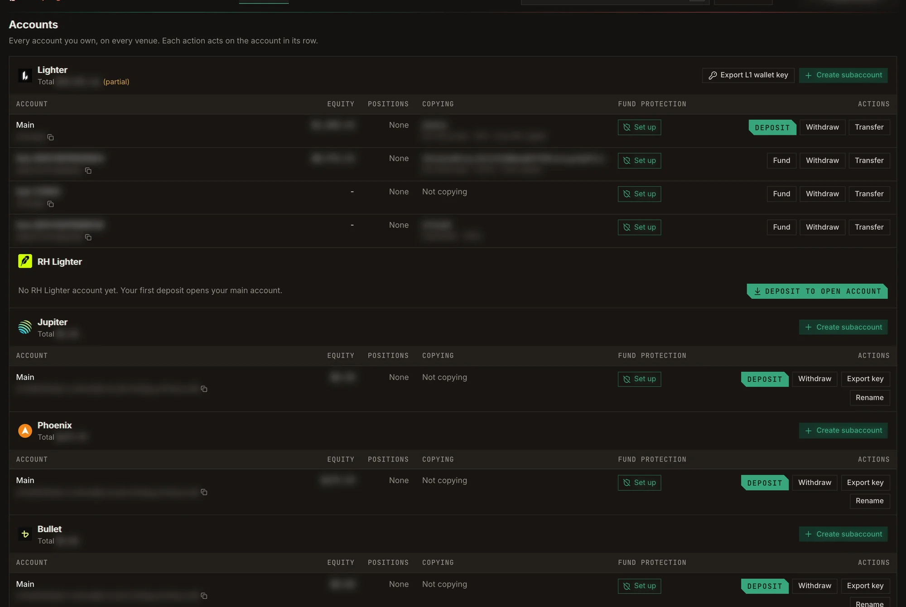

**Accounts** lists every account you own, grouped by venue. Each action in a row acts on the account in that
row: deposit, withdraw, transfer, rename, export its key, and set [Fund protection](/guide/fund-protection). Each
copy trades with one of these accounts.

<Frame caption="Accounts, grouped by venue. Balances and addresses are blurred.">
  
</Frame>

## Open an account

If you have no account on a venue yet, click **Deposit to open account**. Your first deposit opens your main
account there.

To run several copies apart from each other, create more accounts with **Create subaccount**:

- **Lighter:** creates a subaccount under your Lighter main account and enables it for trading.
- **Solana:** creates a new Solana wallet. It is listed under Jupiter, Phoenix and Bullet.

On Lighter and RH Lighter, an account without an API key shows **Not enabled**; click **Enable** before it can
trade or copy.

## Deposit

| Venue | How to deposit |
| --- | --- |
| **Lighter** | Pick a source chain and send native USDC to the address shown. Other tokens do not arrive. There is a minimum deposit. |
| **RH Lighter** | Send USDG on Robinhood Chain only. |
| **Jupiter** | Deposit USDC to your Solana app wallet. |
| **Phoenix** | Move USDC from your Solana app wallet into your Phoenix collateral. Copy trading spends this balance. Keep a little SOL for fees. |
| **Bullet** | Move USDC (Solana SPL USDC) from your Solana app wallet into your Bullet account. The first deposit opens it. There is a cap per deposit. |
| **Aftermath** | Send native USDC on Sui to your Sui deposit address, and keep a little SUI for gas. First time: **Create account and deposit**. |

On Lighter and RH Lighter, use **Fund** on a subaccount to move money into it from your main account.

## Withdraw and transfer

- **Lighter** offers two withdrawal types: **Fast Withdrawal** (a quick transfer to an Arbitrum wallet) and
  **Secure Withdrawal** (to Ethereum through the native bridge, which takes longer).
- **Transfer** moves funds between your own accounts on the same venue. Bullet has no transfer.
- On Aftermath, **Accounts** lets you create more Aftermath accounts and move collateral between them.

Withdrawals ask for a **6-digit code sent to your Telegram** before they go through.

## Export a key

**Export key** reveals the private key of an account's wallet so you can use it elsewhere. It also asks for a
Telegram code first.

- On Lighter and RH Lighter the key is the **L1 wallet key**, exported once for the whole section: it controls
  every account on both Lighter and RH Lighter.
- On Aftermath the key is exported in Sui `suiprivkey` format.

<Warning>
  Anyone with an exported key controls the account's funds. Never paste it into a website or share it.
</Warning>
