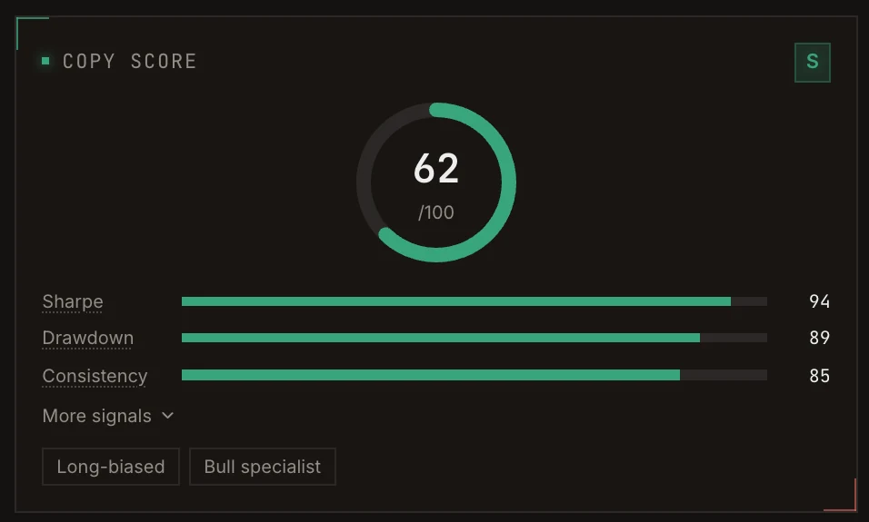

The **Copy Score** (0 to 100) rates how suitable a trader is to copy, from their risk-adjusted performance,
drawdowns and consistency. It answers a different question from PnL: not "who made the most", but "whose
results would survive being copied".

<Frame caption="The Copy Score on a profile. A 62 is S tier here: tiers are percentiles, so the top 1% can score in the 60s.">
  
</Frame>

## Tiers

Tiers are percentiles of all scored wallets on the venue.

| Tier | Meaning | Share of scored wallets |
| --- | --- | --- |
| **S** | Elite | Top 1% |
| **A** | Strong | Next 4% |
| **B** | Average | Next 15% |
| **C** | Below average | Next 30% |
| **D** | Poor, not recommended for copying | Bottom 50% |

## What goes into it

The score is computed over the **last 90 days** of trading.

| Signal | What it measures |
| --- | --- |
| **Sharpe** | Profit earned per unit of volatility. The biggest single input. |
| **Drawdown** | The worst peak-to-trough loss. Shallow drawdowns score high. |
| **Consistency** | Win rate and profit factor combined. |
| **Net PnL** | Whether the wallet actually made money. |

It is then adjusted:

- **Liquidations** lower the score.
- **Thin history** pulls the score toward 50, so a lucky streak cannot reach the top tier.
- **Very high trading frequency** lowers it: a wallet that trades every few seconds is hard to mirror.
- **Uneven position sizes** lower it: sizing that jumps around is hard to copy in proportion.

The profile shows these as **Frequency**, **Sizing** and **Confidence** (how much trade history backs the
score).

## Who gets a score

A wallet needs at least **20 trades** across at least **10 active days**, and a trade in the **last 7 days**.
Wallets that do not qualify show **Insufficient copy history**.

## Bias and Edge

Two tags describe style rather than quality:

- **Bias** is the directional lean: how often the wallet is long versus short (Long-only, Long-biased,
  Balanced, Short-biased, Short-only).
- **Edge** is which side the wallet actually makes money on: **Bull specialist**, **Bear specialist** or
  **Two-sided**.

<Tip>
  A high score with a **Bull specialist** edge can still lose in a falling market. Use Edge to pick traders
  whose strength matches the market you expect, or mix specialists from both sides.
</Tip>
