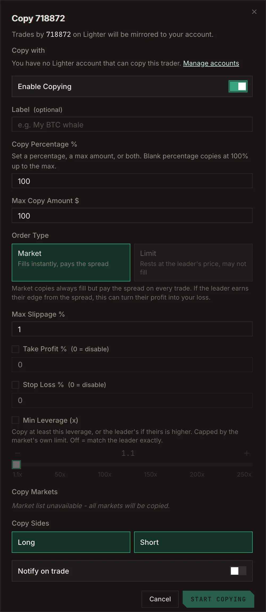
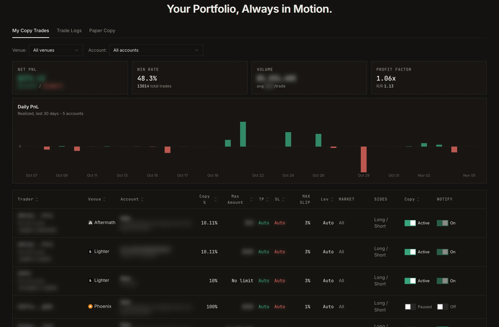
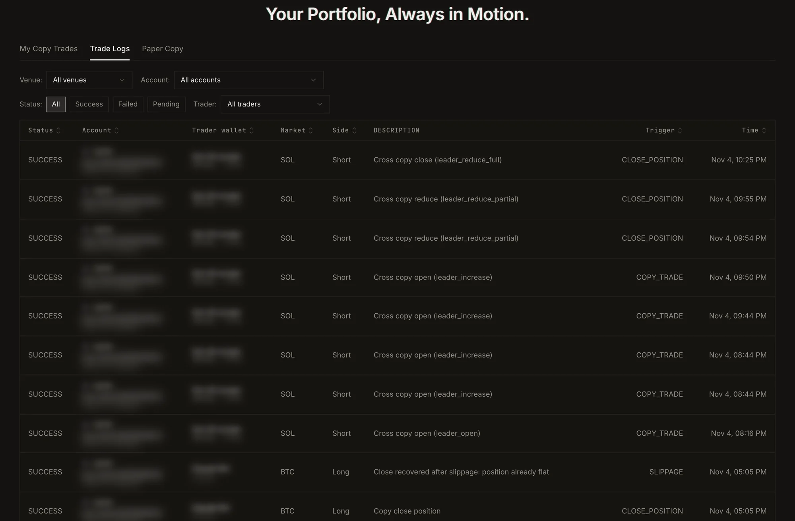

When the trader you copy opens, adds to, trims or closes a position, your account does the same, scaled to your
settings. Orders are placed in your own account on the venue; Perp.ag never holds your funds in a shared pool.

## Start a copy

<Steps>
  <Step title="Open the trader's profile and click Copy Trade">
    The form opens: *Trades by this trader on this venue will be mirrored to your account.*
  </Step>
  <Step title="Choose the account to Copy with">
    Pick one of your accounts. If it is not ready, the form offers shortcuts: **Enable trading**,
    **Deposit** or **Fund from Main**. Each account copies **one trader at a time**; if it already copies
    someone, you are asked whether to stop that copy first. Positions the old copy opened stay open.
  </Step>
  <Step title="Set your size and risk">
    See the settings below.
  </Step>
  <Step title="Click Start Copying">
    The copy is live. Edit it later from **Copy Trade → My Copy Trades** (the button becomes **Save Changes**).
  </Step>
</Steps>

To watch a trader without copying, click **Track** instead: the same form opens with copying switched off.

## Settings

<Frame caption="The copy form.">
  
</Frame>

| Setting | What it does |
| --- | --- |
| **Copy Percentage %** | The share of each of the trader's positions you take. |
| **Max Copy Amount $** | A cap on any single copied position. Set a percentage, a max amount, or both; a blank percentage copies at 100% up to the max. Defaults: 100% and $100. |
| **Leverage** | From 1.1x to 250x, or off to match the trader exactly. On a same-venue Lighter or RH Lighter copy it is a **minimum** (copy at least this leverage, or the trader's if higher); everywhere else it is a **maximum**. |
| **Order Type** | **Market** fills at once and pays the spread. **Limit** rests at the trader's price and may not fill; take profit and stop loss are not attached to a limit open, and closes are always market orders. Same-venue copies only. |
| **Max Slippage %** | Orders that would fill further than this from the price are not chased. Default 1%. A high value raises the risk of being front-run. |
| **Take Profit %** and **Stop Loss %** | Close a copied position at your own targets, whatever the trader does. 0 disables. Not on Bullet. |
| **Copy Markets** | Copy every market, or only the ones you pick. |
| **Copy Sides** | Long, short or both. |
| **Mirror limit orders** | Copy the trader's resting limit orders too. Same-venue Phoenix copies only. |
| **Notify on trade** | Send an alert for each copied trade. |
| **Label** | An optional name for the copy. |

## Pause or stop a copy

- **Pause:** in **My Copy Trades**, flip the copy's toggle to **Paused**. Its settings are kept.
- **Stop:** click **Unfollow**. This removes the copy and its settings.

Either way, **positions the copy already opened stay in your account** for you to manage or close.

## Track your copies

**Copy Trade → My Copy Trades** shows net PnL, win rate, profit factor, volume and your daily realized PnL over
the last 30 days, then one row per copy with its settings and status. Filter by venue and account.

<Frame caption="My Copy Trades: summary, daily realized PnL and one row per copy. Personal details are blurred.">
  
</Frame>

**Trade Logs** lists every copied order: the trader, market, side, what triggered it, its status and time.

<Frame caption="Trade Logs: every copied order and why it fired. Personal details are blurred.">
  
</Frame>

<Note>
  A copy fills after the trader, so your entry and exit prices differ a little from theirs. On fast markets, on
  thin books, or when copying a maker who trades with limit orders, that gap can be significant. Test with a
  [paper copy](/guide/paper-copy) first.
</Note>
