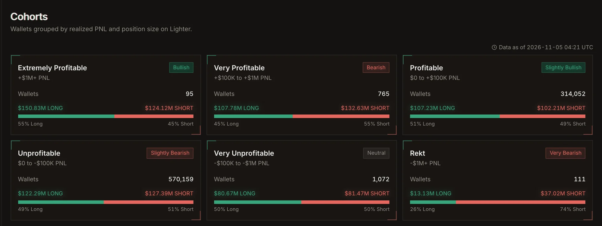
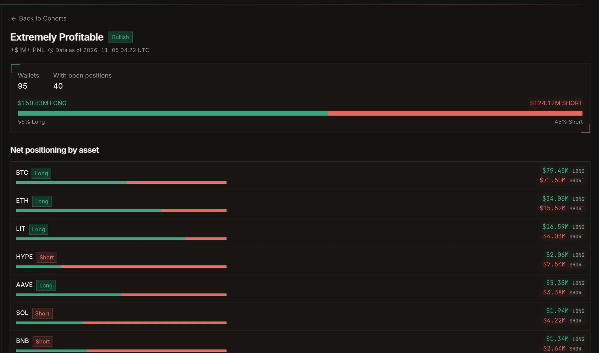
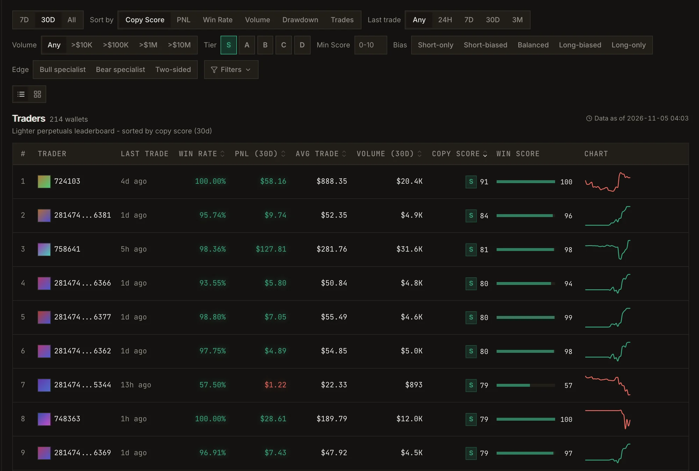

**Explore** is where you find traders. It opens on **Cohorts**: wallets grouped by realized PnL and position
size, with what each group is holding right now.

## Cohorts

Each cohort card shows how many wallets are in the group, their open interest, the long/short split and a
sentiment badge (for example **Bullish** or **Very bearish**). It is a quick read on which way the winners and
the losers are leaning.

<Frame caption="Cohort cards on Explore.">
  
</Frame>

| Cohort | Realized PnL |
| --- | --- |
| Extremely profitable | +$1M or more |
| Very profitable | +$100K to +$1M |
| Profitable | $0 to +$100K |
| Unprofitable | $0 to -$100K |
| Very unprofitable | -$100K to -$1M |
| Rekt | -$1M or worse |

Open a cohort to see its wallets, which of them have open positions, and the long and short exposure per
market. Filter by market and side.

<Frame caption="A cohort in detail: its wallets and their net positioning per market.">
  
</Frame>

## The sidebar lists

- **Cohorts:** the groups above.
- **Best Wallets to Copy Trade:** wallets ranked for copying.
- **Known Traders and Funds:** labeled wallets.
- **Explore All Traders:** the full leaderboard with every filter.
- **Open Positions:** live positions across the wallets we track.

## Leaderboard filters

| Filter | What it does |
| --- | --- |
| **Sort by** | Copy Score, PnL, Win Rate, Volume, Drawdown or Trades |
| **Tier** and **Min Score** | Keep only wallets at a [Copy Score](/guide/copy-score) tier (S to D) or above a score |
| **Bias** | Long-only, Long-biased, Balanced, Short-biased, Short-only |
| **Edge** | Bull specialist, Bear specialist, Two-sided |
| **Volume** | From more than $10K up to more than $10M |
| **Last trade** | Traded in the last 24H, 7D, 30D, 3M, or any time |
| **Range** | Compute the metrics over 7D, 30D or all time |

**Advanced filters** add *greater than*, *less than* and *between* conditions on Profit, PnL After Fee, PnL
Ratio, Win Rate, Drawdown, Trades, Avg Trade Size and Volume, each over 7D, 30D or all time.

<Frame caption="The leaderboard, filtered to S-tier wallets.">
  
</Frame>

The table shows the trader, their last trade, win rate, PnL and volume for the chosen range, their average
trade, their Copy Score with its tier, and a PnL chart. Switch between the table and a grid of cards.

<Tip>
  Sign in to see the full list. You can also paste any address or account index into the search box
  (<kbd>⌘</kbd> <kbd>K</kbd>) to jump straight to a profile.
</Tip>
