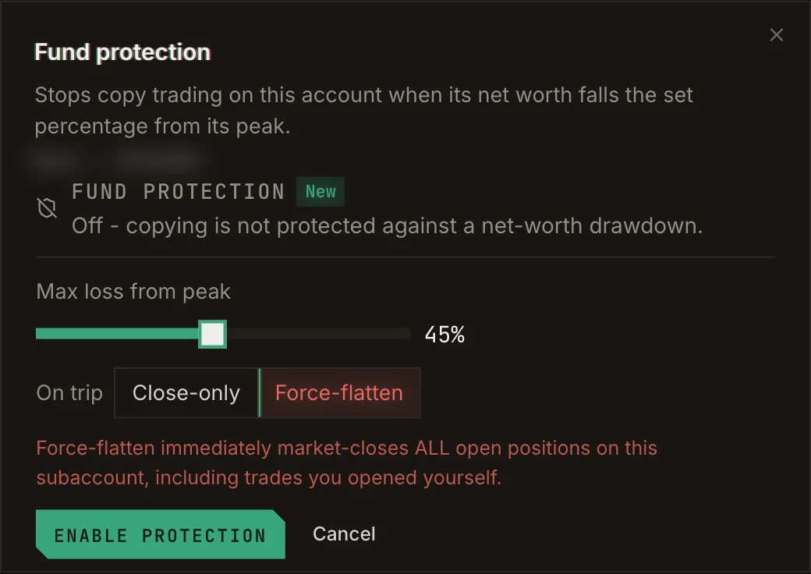

Copying someone should never mean handing them your whole account. **Fund protection** watches an account's
net worth and stops copy trading on it when it falls a set percentage from its peak. It covers every copy on
that account at once.

## Turn it on

<Steps>
  <Step title="Open Accounts">
    Find the account and open its **Fund protection** setting.
  </Step>
  <Step title="Set the max loss from peak">
    Choose how far the account may fall from its highest net worth, between 5% and 90%.
  </Step>
  <Step title="Choose what happens when it trips">
    - **Close-only:** stop opening new copy positions, but keep mirroring the traders' closes so open copies
      wind down naturally.
    - **Force-flatten:** immediately market-close **all** open positions on the account, including trades you
      opened yourself.
  </Step>
</Steps>

<Frame caption="Setting up fund protection on an account.">
  
</Frame>

## States

| State | Meaning |
| --- | --- |
| **Protected** | Copying stops at -X% from peak. |
| **Triggered** | The line was crossed and copying stopped. Click **Resume copying** when you are ready. |
| **Off** | Copying on this account is not protected. |

<Warning>
  **Force-flatten** closes everything on the account at market, including positions you opened by hand. Use
  a separate account for manual trading if you want it left alone.
</Warning>

Fund protection is available on every venue except RH Lighter.
