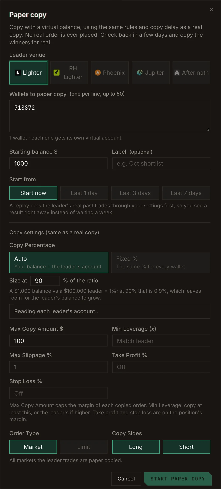
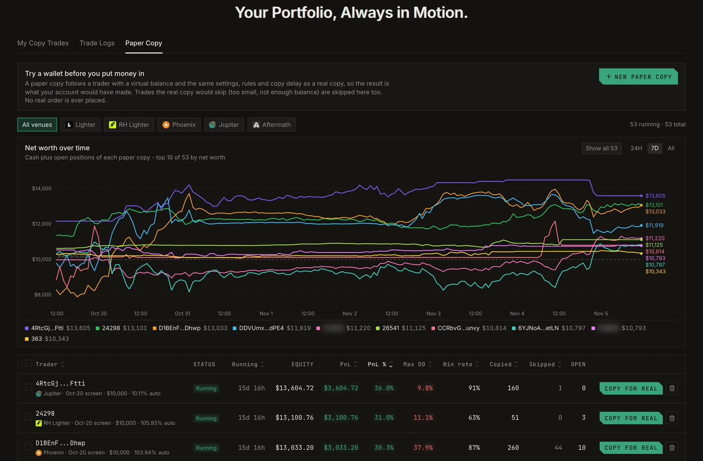
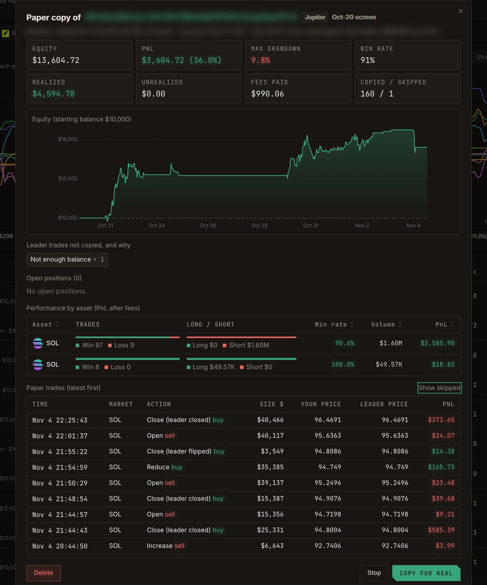

A paper copy follows a trader's **real fills** with **virtual money**, using the same rules and copy delay as a
real copy. No real order is ever placed. Because it trades live markets, its result is close to what a real
copy would have earned, fees and slippage included.

Paper copy is available on every venue except Bullet.

## Start a paper copy

Click **Paper Copy** on a trader's profile, or go to **Copy Trade → Paper Copy → New paper copy**.

| Setting | Meaning |
| --- | --- |
| **Leader venue** | Lighter, RH Lighter, Phoenix, Jupiter or Aftermath. |
| **Wallets to paper copy** | One per line, up to 50. Each wallet gets its own virtual account, so you can race them against each other. |
| **Starting balance $** | The virtual balance each account starts with. |
| **Label** | Optional name. |
| **Start from** | **Start now**, or replay the trader's real trades from the **last 1, 3 or 7 days** first. |
| **Copy Percentage** | **Auto** sizes by your balance divided by the trader's account (and you can scale that ratio), or **Fixed %**. |
| **Max Copy Amount**, **Leverage**, **Max Slippage**, **Take Profit %**, **Stop Loss %**, **Order Type**, **Copy Sides** | The same settings as a real copy. See [Copy trading](/guide/copy-trading). |

<Frame caption="The paper copy form.">
  
</Frame>

## Read the results

The **Paper Copy** list shows each paper account's status (Running, Stopped or Liquidated), how long it has run,
equity, PnL %, max drawdown, win rate, and how many trades were copied and skipped.

<Frame caption="Paper copies racing each other: net worth over time and one row per paper account.">
  
</Frame>

Open one to see its equity chart, realized and unrealized PnL, fees paid, open positions, performance by asset,
every paper trade with **your price** next to **the leader's price**, and the list of **leader trades not
copied, and why**.

<Frame caption="One paper copy in detail: your price next to the leader price on every trade.">
  
</Frame>

## Go live

When a paper copy has earned your trust, click **Copy for real**. The real copy form opens with the same
settings filled in.

<Tip>
  Run several paper copies side by side for a week, then copy the one with the best result *after* fees and
  slippage, not the trader with the best PnL on paper.
</Tip>
