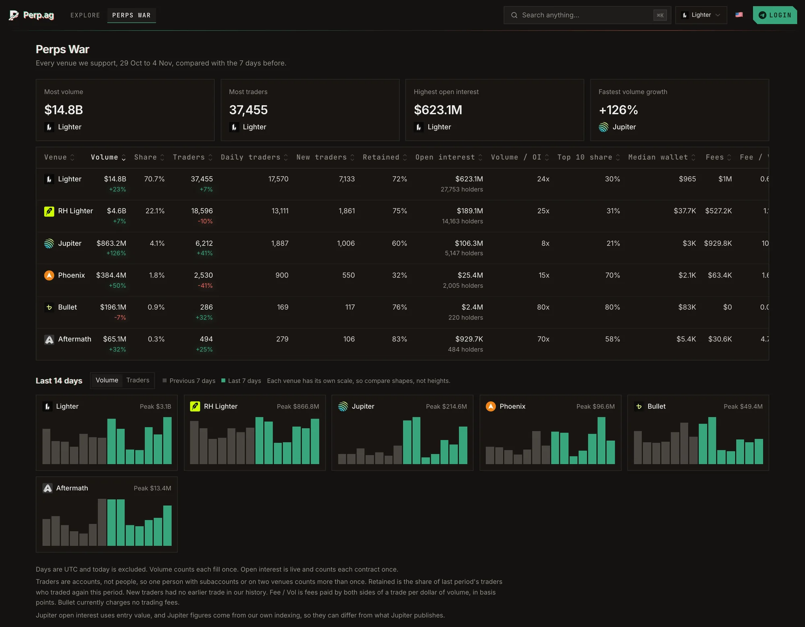

**Perps War** ranks the venues against each other over the last 7 days, using the same trade data that powers
the rest of Perp.ag.

<Frame caption="Perps War: six venues over the last 7 days.">
  
</Frame>

| Metric | Meaning |
| --- | --- |
| **Volume** | Traded notional. Order-book venues count both sides of each trade, so compare like with like. |
| **Traders** | Wallets that traded in the window. |
| **Open interest** | Size of open positions. |
| **Fees** | Trading fees paid. |
| **Fee / Vol** | Fees as a share of volume: how expensive the venue is to trade. |
| **Volume / OI** | How hard open interest is being turned over. |
| **New traders** | Wallets trading on the venue for the first time. |
| **Retained** | Traders who came back. |
| **Daily traders** | Average wallets trading per day. |
| **Median wallet** | The typical trader's size. |
| **Top 10 share** | How much of the volume the ten biggest wallets account for. |
| **Share** | The venue's share of the total across all venues. |

Callouts name the venue with the **most volume**, the **most traders**, the **highest open interest** and the
**fastest volume growth**.
