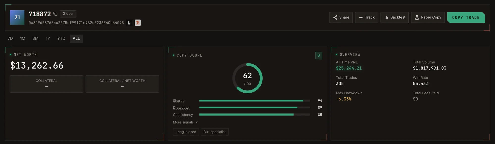
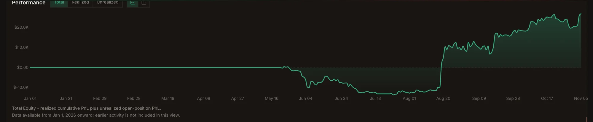
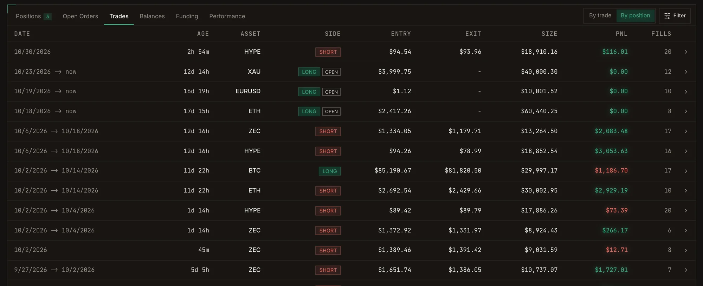

Every wallet has a profile. Pick a range at the top (**7D, 1M, 3M, 1Y, YTD, ALL**) and every number on the page
follows it.

<Frame caption="A trader profile: actions, net worth, Copy Score and overview.">
  
</Frame>

## Actions

| Button | What it does |
| --- | --- |
| **Track** | Watch the wallet without copying it. You can switch copying on later. |
| **Backtest** | Replay the wallet's past trades against your settings. See [Backtest](/guide/backtest). |
| **Paper Copy** | Copy with virtual money from now on. See [Paper copy](/guide/paper-copy). |
| **Copy Trade** | Mirror the wallet into one of your accounts. See [Copy trading](/guide/copy-trading). |
| **Share** | Share the profile. |

The header also links to the venue's explorer, and shows a label when the wallet belongs to a known trader
or fund.

## What the profile shows

<AccordionGroup>
  <Accordion title="Account value">
    Net worth, collateral, collateral as a share of net worth, and the long/short balance of open positions.
  </Accordion>
  <Accordion title="Copy Score">
    The 0 to 100 score with its sub-scores: Sharpe, Drawdown and Consistency, and under **More signals**
    Frequency, Sizing and Confidence. Bias and Edge tags describe the trading style. See
    [Copy Score](/guide/copy-score).
  </Accordion>
  <Accordion title="Overview, Analysis and Performance">
    All-time PnL, total volume, total trades, win rate, max drawdown and total fees paid; the long/short split,
    PnL cohort and size cohort (Small, Medium, Large, Whale), profit factor, total profit and total loss;
    expected value, PnL after fee and total liquidations.
  </Accordion>
  <Accordion title="PnL chart">
    Realized PnL, unrealized PnL and total equity (realized plus unrealized), per day or cumulative.
  </Accordion>
  <Accordion title="Tabs">
    - **Positions:** what the wallet holds now.
    - **Open Orders:** resting limit, take-profit and stop-loss orders.
    - **Trades:** every fill, or grouped **by position** from open to close.
    - **History:** older trade history (Lighter and Jupiter).
    - **Balances** and **Funding:** deposits, withdrawals and transfers.
    - **Asset performance:** PnL, win rate, volume and trades per market.
  </Accordion>
</AccordionGroup>

<Frame caption="Total equity over time: realized PnL plus open positions.">
  
</Frame>

<Frame caption="The Trades tab, grouped by position from open to close.">
  
</Frame>

## Style tags

Tags call out how the trader makes money: **Bull specialist** or **Bear specialist** (their edge is on one
side), **Two-sided**, and their directional lean, from **Long-only** to **Short-only**.
