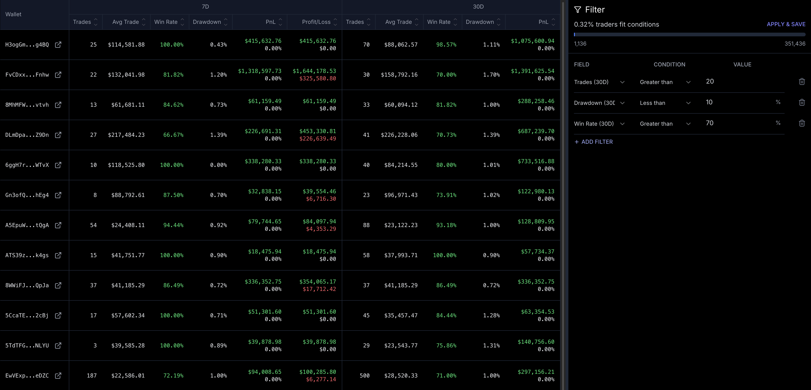
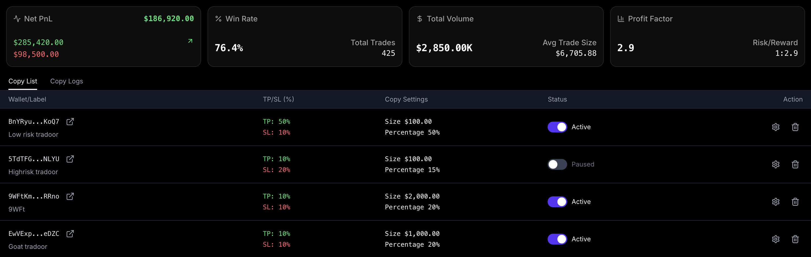
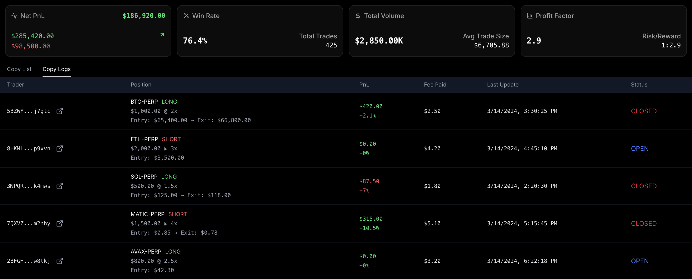

# How to Copy Trading

Copy trading on Perp.ag is designed to be simple and intuitive. Follow these three steps to start earning passive profits.

<Steps>
  <Step title="Step 1: Discover Top Traders to Copy">
    Finding winning traders is hard. Perp.ag makes it simple by ranking top-performing accounts based on real on-chain PnL, strategy, and consistency. This allows you to copy the best traders, not just the loudest ones on social media.
    
  </Step>
  <Step title="Step 2: Set Up Once, Let It Ride">
    No complex bots or code are needed. Simply choose your trader, set your risk parameters, and Perp.ag will mirror their trades on your account using Solana's lightning-fast execution. You always remain in control of your funds.
    
  </Step>
  <Step title="Step 3: Monitor Profits While You Enjoy Life">
    Your portfolio updates in real-time. You can see exactly how much you're making, how trades are performing, and when to adjust your strategy. All of this is available while Perp.ag does the heavy lifting for you.
    
  </Step>
</Steps>
