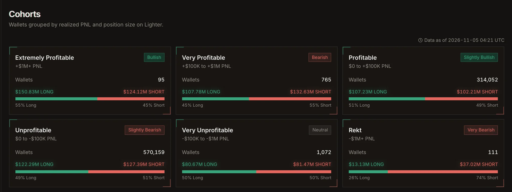

<Note>
  Perp.ag is in **private testing**. A small group of testers has access while we harden copy execution
  against live markets. Follow [@perp_ag on X](https://x.com/perp_ag) for the public launch.
</Note>

## What is Perp.ag

Most perp traders lose money. Of the 885,273 wallets we track on Lighter, 570,809 (64%) are in the red on
their closed trades, and only about 1 in 1,000 has made more than $100K.

Perp.ag is built around that fact. Instead of trading alone, you find the small group of wallets with a real,
repeatable edge and copy them:

1. **Find.** We score every perp wallet on six venues with a **Copy Score** from 0 to 100, graded S to D.
2. **Test.** Backtest a trader against their own history, or run a **paper copy** with virtual money that
   follows their real fills.
3. **Copy.** When the trader opens, adds, trims or closes, your account does the same, scaled to your settings.
4. **Protect.** Size caps, leverage limits, take profit, stop loss and an account-wide breaker keep a copy
   from taking more than you planned.
5. **Watch.** Daily PnL, every copied trade in the logs, and the venues ranked against each other.

<Frame caption="Explore: every wallet grouped by realized PnL, with what each group holds right now.">
  
</Frame>

## Supported venues

Perp.ag covers **Lighter, RH Lighter (Lighter on Robinhood Chain), Jupiter, Phoenix, Bullet and Aftermath**,
for both analytics and copy trading. See [Venues](/venues) for what each one supports.

## Where to go next

<CardGroup cols={2}>
  <Card title="Quickstart" icon="rocket" href="/quickstart">
    Sign in, fund an account and start your first copy in a few minutes.
  </Card>
  <Card title="Copy Score" icon="gauge" href="/guide/copy-score">
    How we rate a trader, and what each tier means.
  </Card>
  <Card title="Copy trading" icon="copy" href="/guide/copy-trading">
    Every copy setting, explained.
  </Card>
  <Card title="Data API" icon="database" href="/api/overview">
    Use our trader analytics in your own product.
  </Card>
</CardGroup>

<Warning>
  Copy trading carries real risk. A trader's past results do not guarantee future ones, and a copy can lose
  money even when the trader does not, because of fees, slippage and timing. Nothing in these docs is
  financial advice.
</Warning>
