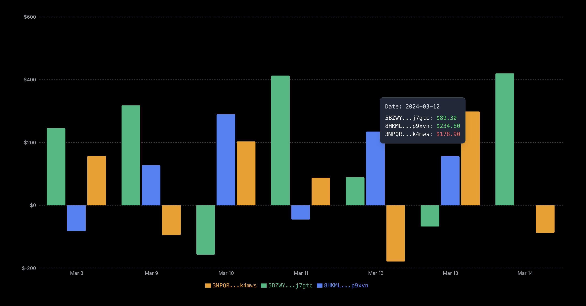

# Overview

Perp.ag is a decentralized platform that brings passive profits to your pocket through advanced copy-perp trading. We make it simple to find and copy top-performing traders on Solana, so you can benefit from their expertise without the emotional stress and data overload of trading on your own.

## The Problem with Perpetual Trading

Perpetual trading can be a rollercoaster. Many traders experience:
- **Emotional Decisions:** Fear and greed leading to poor choices.
- **Lack of Clarity:** Difficulty in understanding market trends.
- **Data Overload:** Too much information to process effectively.
- **Losses and Missed Opportunities:** The constant struggle to stay profitable.

Perp.ag is designed to solve these problems by allowing you to copy the strategies of seasoned professionals.

## Key Features

- **Discover Pro Traders:** Find traders who are making consistent profits with a variety of strategies. We rank them based on real on-chain PnL, strategy, and consistency.
- **Execute with Ease:** Copy trades with lightning-fast execution on Solana. No complex bots or coding required.
- **Monitor Your Profits:** Your portfolio updates in real-time, so you can see exactly how much you're making and how your copied trades are performing.
- **Stay in Control:** You always have control over your funds. Set your risk parameters and let Perp.ag handle the rest.
- **Multi-Exchange Support:** Initially supporting Jupiter Perps, with plans to expand to other DEXs and CEXs like Drift, Binance, Bybit, and more.
