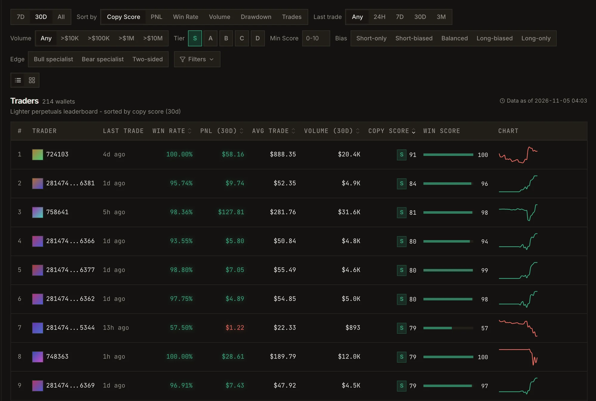
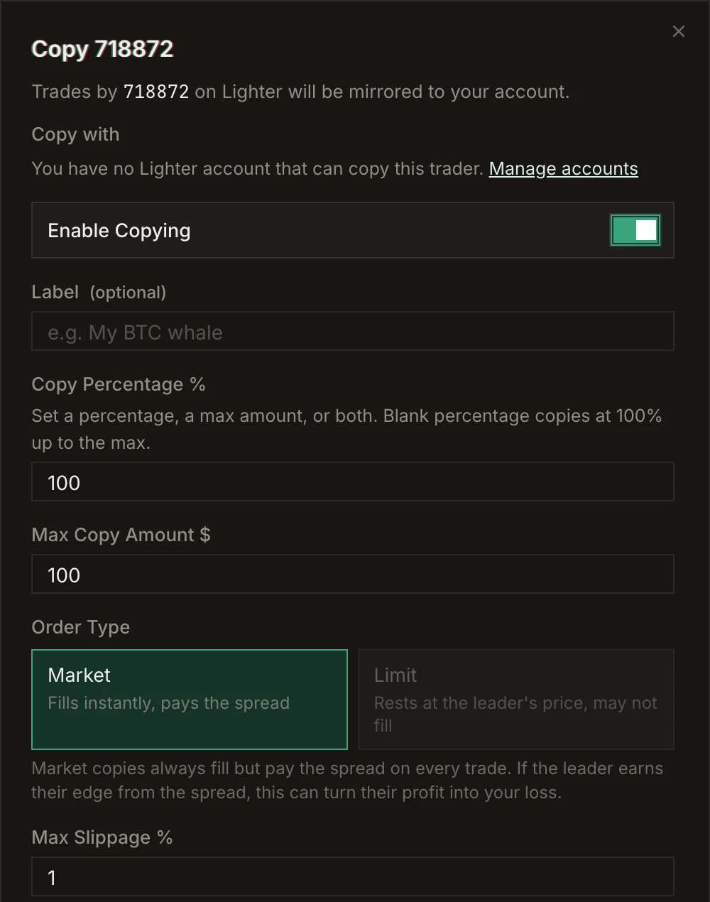
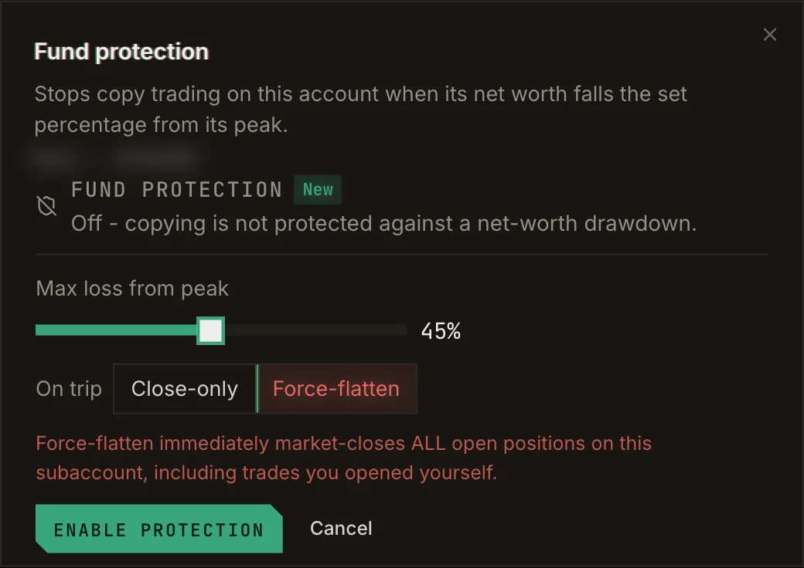
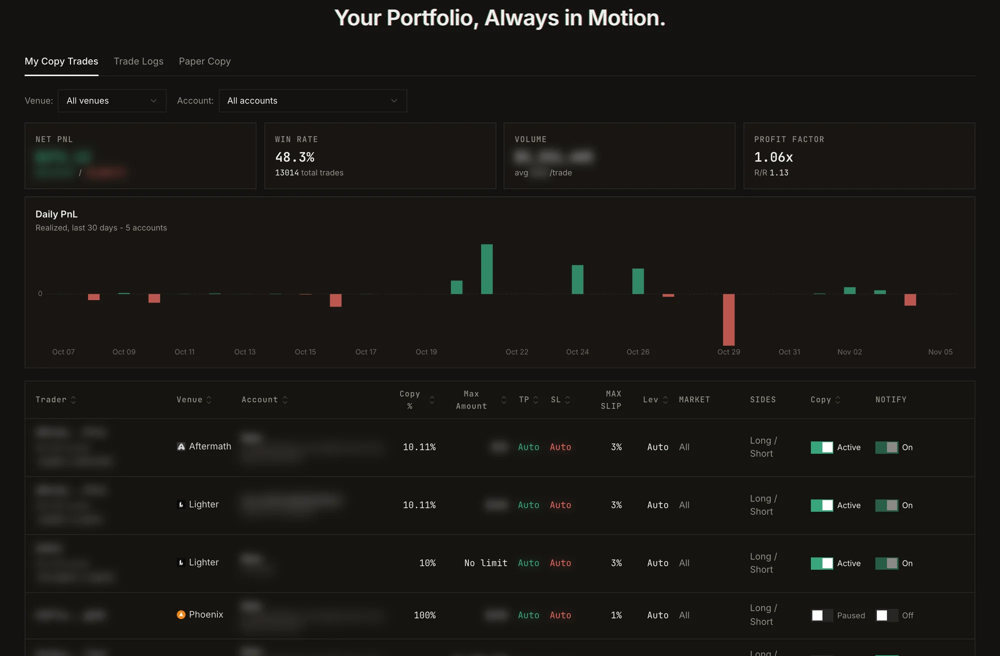

<Steps>
  <Step title="Sign in with Telegram">
    Open [app.perp.ag](https://app.perp.ag) and click **Login**. The Perp.ag Telegram bot opens; start it and it
    sends you back to the app, signed in. There is no wallet-connect login: your Telegram account is your
    Perp.ag account. See [Login and alerts](/guide/login-and-alerts).
  </Step>
  <Step title="Fund an account on the venue you want to trade">
    Go to **Accounts**. Each venue has its own section. If you have no account there yet, click
    **Deposit to open account**: your first deposit opens your main account. Lighter, Jupiter, Phoenix,
    Bullet and Aftermath settle in USDC; RH Lighter settles in USDG on Robinhood Chain. See
    [Accounts](/guide/accounts) for the per-venue details.
  </Step>
  <Step title="Find a trader">
    Open **Explore**. Sort by **Copy Score**, filter by tier, bias, edge, volume and last trade, or browse
    the cohorts and the **Best Wallets to Copy Trade** list. Click a wallet to open its profile. See
    [Explore](/guide/explore).

    <Frame caption="The leaderboard, filtered to S-tier wallets and sorted by Copy Score.">
      
    </Frame>
  </Step>
  <Step title="Test them first (recommended)">
    On the trader's profile, click **Backtest** to replay their history against your settings, or
    **Paper Copy** to follow them with virtual money from now on. See [Paper copy](/guide/paper-copy).
  </Step>
  <Step title="Start copying">
    Click **Copy Trade** on the profile. Pick the account to **Copy with**, set your size (a copy percentage,
    a max amount, or both), leverage, take profit, stop loss and slippage, then click **Start Copying**.
    See [Copy trading](/guide/copy-trading).

    <Frame caption="The copy form.">
      
    </Frame>
  </Step>
  <Step title="Set a breaker">
    In **Accounts**, turn on **Fund protection** for the account. If its net worth falls the percentage you
    choose from its peak, copying on it stops. See [Fund protection](/guide/fund-protection).

    <Frame caption="The fund protection setting.">
      
    </Frame>
  </Step>
  <Step title="Watch it run">
    **Copy Trade → My Copy Trades** shows each copy's settings and your daily realized PnL. **Trade Logs**
    lists every copied order and its status. Turn on **Notify on trade** to get an alert for each one.

    <Frame caption="My Copy Trades.">
      
    </Frame>
  </Step>
</Steps>
