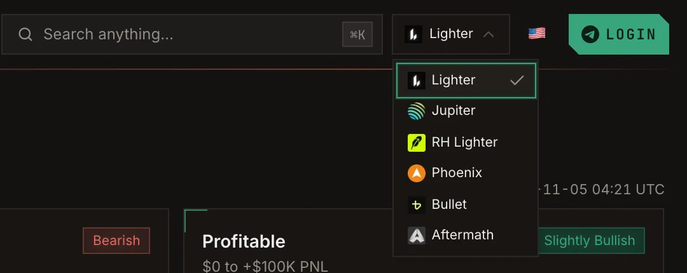

Use the venue switcher in the top bar to choose which venue's data you are looking at. Every venue below
supports both analytics and copy trading.

<Frame caption="The venue switcher in the top bar.">
  
</Frame>

| Venue | Chain | Settles in | Analytics | Copy | Paper copy |
| --- | --- | --- | --- | --- | --- |
| **Lighter** | Lighter (Ethereum L2) | USDC | Yes | Yes | Yes |
| **RH Lighter** | Lighter on Robinhood Chain | USDG | Yes | Yes | Yes |
| **Jupiter** | Solana | USDC | Yes | Yes | Yes |
| **Phoenix** | Solana | USDC | Yes | Yes | Yes |
| **Bullet** | Solana | USDC | Yes | Yes | No |
| **Aftermath** | Sui | USDC | Yes | Yes | Yes |

## Differences between venues

<AccordionGroup>
  <Accordion title="Cross-venue copy">
    You can follow a trader on one venue and execute the copy on another. Traders on Lighter, RH Lighter,
    Phoenix or Jupiter can be copied onto **Lighter, RH Lighter or Phoenix**. Jupiter can lead a cross-venue
    copy but cannot execute one, and Bullet copies are same-venue only. See
    [Cross-venue copy](/guide/cross-venue-copy).
  </Accordion>
  <Accordion title="Leverage limit: minimum or maximum">
    On a same-venue Lighter or RH Lighter copy the leverage setting is a **minimum**: you copy at least that
    leverage, or the trader's if theirs is higher. Everywhere else, including every cross-venue copy, it is a
    **maximum**: a copy never goes above it.
  </Accordion>
  <Accordion title="Mirror limit orders">
    Only same-venue Phoenix copies can mirror the trader's resting limit orders.
  </Accordion>
  <Accordion title="Features not on every venue yet">
    - **RH Lighter:** no Fund protection, no Open Orders tab, and you cannot close or set TP/SL on your own
      positions from Perp.ag yet.
    - **Bullet:** no take profit or stop loss on copies, no paper copy, no unrealized PnL curve, and you
      cannot close or set TP/SL on your own positions from Perp.ag yet.
  </Accordion>
</AccordionGroup>

## Who you are looking at

On Lighter and RH Lighter a trader is identified by their **account index**, a number such as `35346`. On
Jupiter, Phoenix and Bullet it is their Solana wallet address. On Aftermath it is the account object id on
Sui.
